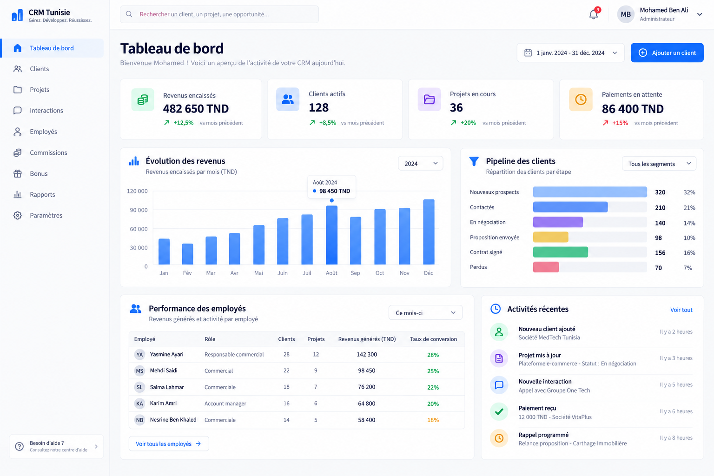

# CRM Tunisie



Application CRM interne construite avec Next.js 16 (App Router), TypeScript, Supabase, Tailwind CSS et shadcn/ui. Elle gère les employés, clients, interactions, projets, paiements, commissions et bonus avec une séparation stricte des rôles au niveau PostgreSQL.

## Fonctionnalités

- Authentification Supabase sans inscription publique.
- Rôles `admin` et `employee` protégés par Row Level Security.
- Fiches clients détaillées : identifiant lisible, agence, contact et poste,
  secteur, réseaux sociaux, responsable, projets et situation financière.
- Interactions : message, email, téléphone, meeting en ligne ou face à face.
  Objectif, résultat, score d’intérêt sur 10 et prochaine action facultative pour tous ;
  date, heure et durée pour les appels et meetings, conclusion pour les emails et messages.
- Projets, paiements multiples, montant payé et solde automatiques.
- Barèmes de commission et de bonus administrables.
- Taux et montants historiques figés au paiement complet d’un projet.
- Dashboards administrateur/employé, rapports et recherche globale.
- Gestion des employés via l’API Admin Supabase côté serveur uniquement.
- Journal d’activité, notifications et interface responsive.

## 1. Prérequis

- Node.js 20.9 ou plus récent.
- Un projet Supabase.
- npm.

## 2. Installer le projet

```bash
npm install
```

## 3. Configurer Supabase

Dans Supabase, ouvrez **SQL Editor**, créez une nouvelle requête puis exécutez
les migrations dans cet ordre :

```text
supabase/migrations/202609180001_initial_crm.sql
supabase/migrations/202609210001_client_communication_details.sql
supabase/migrations/202609210002_client_contact_requirements.sql
supabase/migrations/202609210003_custom_sector_and_service.sql
supabase/migrations/202609220001_optional_client_details.sql
supabase/migrations/202609220002_unique_client_identifiers.sql
supabase/migrations/202609220003_simplify_interactions.sql
```

La migration crée les tables, index, triggers, fonctions financières, données de configuration et politiques RLS.

Dans **Authentication > Providers > Email**, gardez le fournisseur Email actif. Dans **Authentication > Settings**, désactivez l’inscription publique : les employés sont créés depuis `/admin/employees`.

### Créer le premier administrateur

1. Créez manuellement un utilisateur dans **Authentication > Users > Add user**.
2. Le trigger de la migration crée automatiquement son profil.
3. Exécutez dans SQL Editor :

```sql
update public.profiles
set role = 'admin'
where email = 'admin@votreentreprise.tn';
```

Remplacez l’adresse par celle du compte créé.

### Données de démonstration facultatives

Après avoir créé au moins un utilisateur, exécutez :

```text
supabase/seed.sql
```

Le script ajoute des clients tunisiens, une interaction, un projet et un paiement de démonstration. Les barèmes par défaut sont déjà installés par la migration principale.

## 4. Variables d’environnement

Copiez `.env.example` vers `.env.local` :

```bash
cp .env.example .env.local
```

Sous PowerShell :

```powershell
Copy-Item .env.example .env.local
```

Puis configurez :

```dotenv
NEXT_PUBLIC_SUPABASE_URL=https://YOUR_PROJECT_REF.supabase.co
NEXT_PUBLIC_SUPABASE_PUBLISHABLE_KEY=sb_publishable_xxxxxxxxxxxxxxxxx
SUPABASE_SERVICE_ROLE_KEY=sb_secret_xxxxxxxxxxxxxxxxx
NEXT_PUBLIC_APP_URL=http://localhost:3000
```

Les deux premières valeurs se trouvent dans **Project Settings > API**. La clé `SUPABASE_SERVICE_ROLE_KEY` est strictement serveur : ne la préfixez jamais par `NEXT_PUBLIC_` et ne la publiez jamais dans Git. Elle sert uniquement à créer les comptes employés.

Si votre projet Supabase affiche encore une clé `anon` au lieu d’une clé publishable, utilisez sa valeur dans `NEXT_PUBLIC_SUPABASE_PUBLISHABLE_KEY`.

## 5. Lancer localement

```bash
npm run dev
```

Ouvrez [http://localhost:3000](http://localhost:3000), puis connectez-vous avec le compte administrateur.

Commandes de contrôle :

```bash
npm run typecheck
npm run lint
npm run build
```

## Sécurité et calculs financiers

- Toutes les Server Actions revérifient la session et le rôle.
- Les employés ne voient que leurs clients, projets, interactions, paiements et revenus.
- Les règles, paramètres, journaux globaux et employés sont réservés aux administrateurs.
- `payments` est la source de vérité. Un trigger recalcule `payment_amount`, `remaining_amount` et `payment_status`.
- Lorsqu’un projet est entièrement payé, Supabase enregistre `commission_rate_applied`, `commission_amount`, `bonus_amount` et `commission_locked_at`. Un changement futur du barème ne modifie donc pas l’historique.
- Le palier de bonus le plus élevé atteint est appliqué une seule fois au projet.

## Routes principales

| Route                     | Accès    | Usage                                   |
| ------------------------- | -------- | --------------------------------------- |
| `/dashboard`              | Tous     | KPI et activité                         |
| `/clients`                | Tous     | Liste, recherche et filtres             |
| `/clients/[id]`           | Autorisé | Fiche, projets, interactions, paiements |
| `/projects`               | Tous     | Suivi des projets et soldes             |
| `/projects/[id]`          | Autorisé | Paiements et détail de commission       |
| `/interactions`           | Tous     | Historique des communications           |
| `/earnings`               | Employé  | Commissions et bonus personnels         |
| `/admin/employees`        | Admin    | Création et activation des comptes      |
| `/admin/commission-rules` | Admin    | Barème des commissions                  |
| `/admin/bonus-rules`      | Admin    | Barème des bonus                        |
| `/admin/reports`          | Admin    | Rapports consolidés                     |
| `/admin/settings`         | Admin    | Configuration et audit                  |

## Déploiement

Déployez sur Vercel ou sur un serveur Node.js. Ajoutez les quatre variables d’environnement dans la plateforme, définissez `NEXT_PUBLIC_APP_URL` avec l’URL publique et lancez `npm run build`.

Pour plusieurs instances auto-hébergées, définissez aussi une valeur stable de `NEXT_SERVER_ACTIONS_ENCRYPTION_KEY`, conformément à la documentation Next.js.
